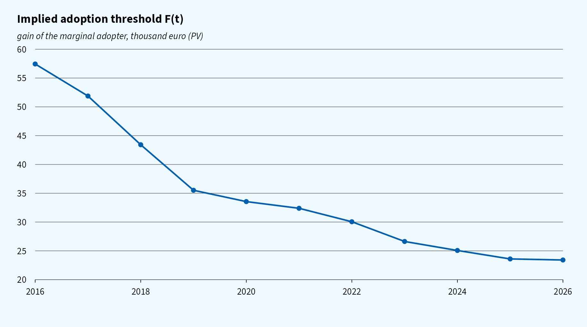
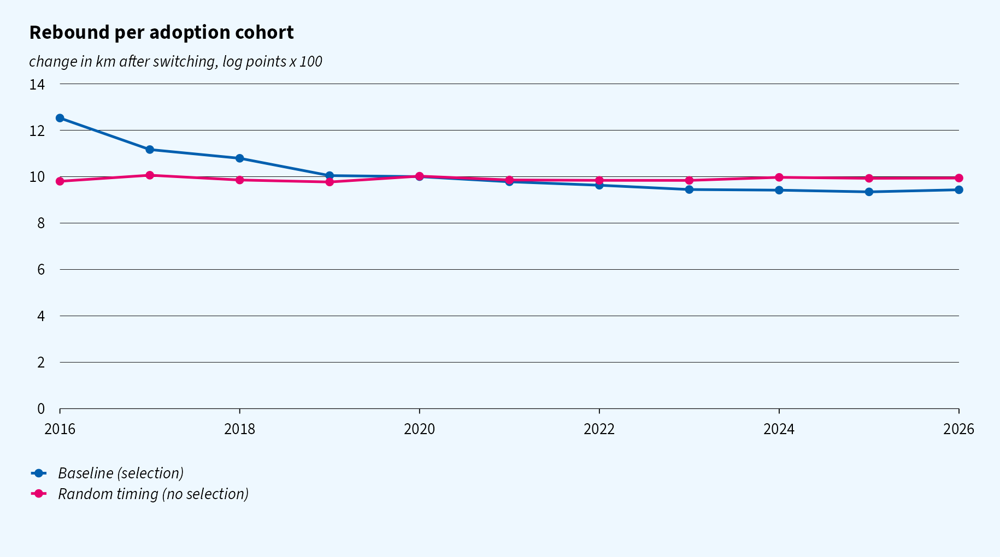
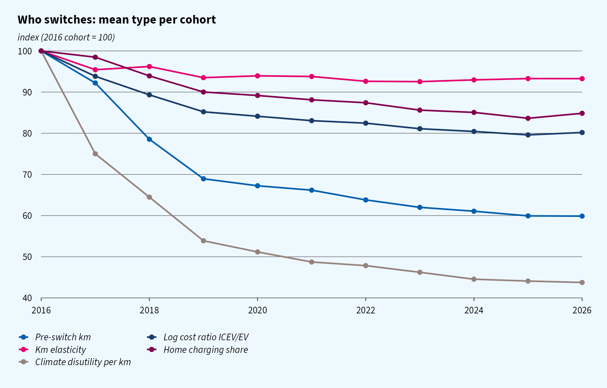
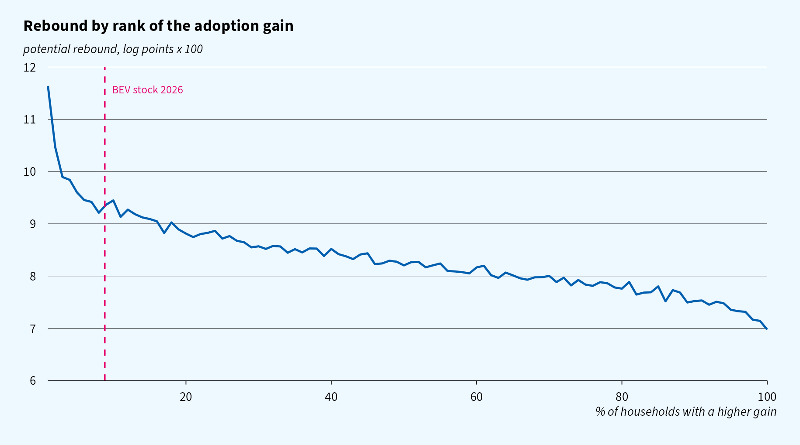
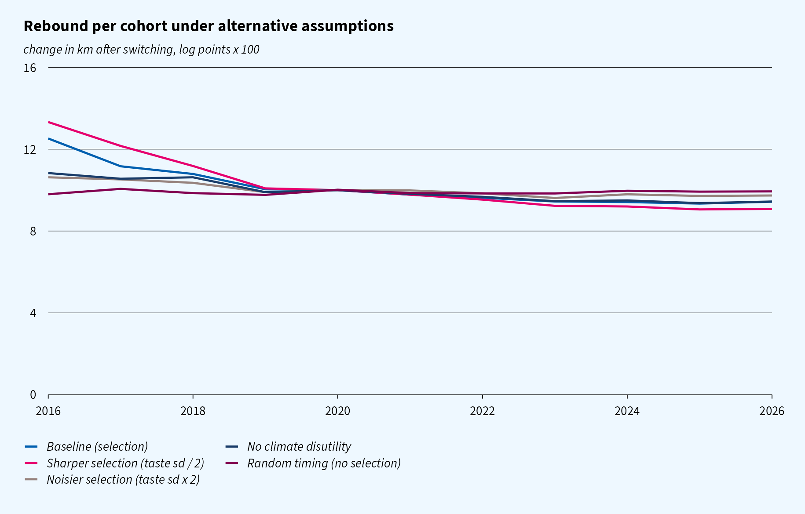
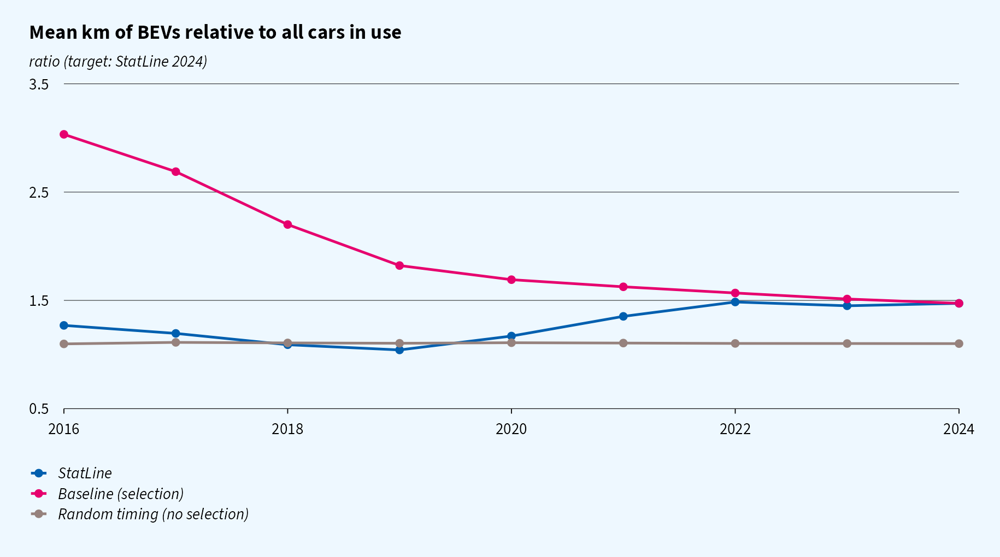

```{r setup, include = FALSE}
library(data.table)
knitr::opts_chunk$set(echo = FALSE, message = FALSE, warning = FALSE, out.width = "100%")

res <- readRDS("../output/results.rds")
statline <- fread("../data/statline_bev_share.csv")
p <- res$params
cal <- res$calibrated
coh <- res$cohorts[cohort >= min(p$years)]
base <- coh[scenario == "baseline"]

fmt <- function(x, d = 1) formatC(x, format = "f", digits = d, big.mark = ",")
pct <- function(x, d = 1) fmt(100 * x, d)
eps_base <- cal[scenario == "baseline", eps_mean]
g_sd_base <- cal[scenario == "baseline", g_sd]
r_first <- base[cohort == min(cohort), rebound_log]
r_last <- base[cohort == max(cohort), rebound_log]
km_first <- base[cohort == min(cohort), km_ice]
km_last <- base[cohort == max(cohort), km_ice]
rand <- coh[scenario == "random_timing", rebound_log]
```

<div class="placeholder">
**Status.** This is a working model. The rebound target (10 log points for the 2020 cohort)
is a **fictitious placeholder**. It will be replaced by rebound estimates per cohort from
Dutch register data. All rebound levels below are illustrative. What carries over is the
mechanism and the *shape* of the cohort profile.
</div>

# Question

Empirically, the rebound in driving after a household switches from an internal combustion
engine vehicle (ICEV) to a battery electric vehicle (BEV) appears to fall with each later
adoption cohort.

The hypothesis is **selection on gains**. The households for whom the ICEV is most
constraining switch first, because they have the most to gain from cheap electric km. They
are constrained in two ways:

- they face a high cost per km and respond strongly to it;
- they experience a high climate disutility per km driven.

The same characteristics make them drive more once they switch. As the EV premium falls,
adoption moves down the distribution of gains, and the marginal adopter rebounds less.

This page develops a minimal model of that mechanism and calibrates it to the Dutch BEV
diffusion curve. The aim is to show:

1. under which assumptions the hypothesis produces a declining cohort profile;
2. how this relates to the S-curve of diffusion;
3. which moments of the data discipline the model.

# Related literature

**Diffusion and the S-curve.** Two families of diffusion models generate an S-curve (survey
in [Geroski 2000](https://consensus.app/papers/details/e034aee1875356b48442448e7a03cd43/)):

- **Epidemic or Bass models**: adoption spreads through information and imitation. The
  timing of adoption is, to first order, unrelated to the adopter's type.
- **Rank or probit (threshold) models** (David 1969; Davies 1979;
  [Chatterjee & Eliashberg 1990](https://consensus.app/papers/details/32b2969947ec5f9e905ffba0ed3d1f4f/)): households differ
  in their gain from adopting. A falling cost threshold moves through the distribution of
  gains, so the S-curve *is* that distribution. Adoption order is systematic in type.

Our model belongs to the second family. This immediately gives a testable contrast: a rank
model predicts a cohort gradient in rebound, an epidemic model predicts none.

**Selection on gains.** In treatment-effect language, a cohort gradient is a downward-sloping
marginal treatment effect curve (Heckman & Vytlacil 2005). The closest analogue in
technology adoption is [Suri (2011)](https://nber.org/system/files/working_papers/w15346/w15346.pdf) on hybrid maize: the
farmers with low returns are precisely those who do not adopt.

**Rebound and joint vehicle and usage choice.** Usage conditional on technology choice is the
classic discrete–continuous problem (Dubin & McFadden 1984).
[Frondel, Martínez Flores & Vance](https://eldorado.tu-dortmund.de/items/630805bf-5edf-4446-8582-13c944f66855)
show that heterogeneous rebound estimates are sensitive to how selection is handled.

**EV usage.** EVs have often been found to be driven *less* than ICEVs:

- [Davis 2019](https://ideas.repec.org/a/taf/apeclt/v26y2019i18p1497-1502.html);
- [Burlig et al. 2021](https://www.nber.org/papers/w28451);
- for the Netherlands, [Zhang et al. 2024](https://www.sciencedirect.com/science/article/pii/S0965856424003732).

Early-adopter self-selection is one of the explanations offered. To our knowledge, no
existing study links the shape of the diffusion curve to how rebound changes across
adoption cohorts.

# Model

## Households and driving

A household $i$ owns one car. Its type is $\theta_i = (k_i, \varepsilon_i, \psi_i, h_i, g_i)$.
The perceived cost per km is

$$
c^I_i = p_f + \psi_i \quad\text{(ICEV)}, \qquad
c^E_i = h_i\,p_{home} + (1-h_i)\,p_{public} \quad\text{(EV)},
$$

where:

- $p_f$ is the fuel cost per km;
- $\psi_i \ge 0$ is a **per-km climate disutility**, a moral cost that the household bears
  for every km it drives with an ICEV;
- $h_i$ indicates access to (cheap) home charging.

Km demand has a constant elasticity $\varepsilon_i$:

$$
v_i(c) = k_i\left(\frac{c}{c^I_i}\right)^{-\varepsilon_i},
$$

so $k_i$ is the km driven with the ICEV.

## Rebound

The individual rebound is the log change in km when the household switches:

$$
r_i = \ln v_i(c^E_i) - \ln v_i(c^I_i) = \varepsilon_i \ln\frac{c^I_i}{c^E_i}.
$$

Removing the climate disutility works exactly like a fall in the price of km. A household
that cares about the climate *per km* drives more once the moral cost disappears.

## Adoption

The annual surplus gain from cheaper km is the area under the demand curve between the two
costs:

$$
\Delta CS_i = \int_{c^E_i}^{c^I_i} v_i(c)\,dc = \frac{k_i\,c^I_i}{1-\varepsilon_i}\left[1-\left(\frac{c^E_i}{c^I_i}\right)^{1-\varepsilon_i}\right].
$$

The total gain is $G_i = A\,\Delta CS_i + g_i$. Here $A$ is an annuity factor
($H = `r p$horizon`$ years at $`r 100 * p$disc`\%$), and $g_i \sim N(0,\sigma_g^2)$ collects
every lump-sum consideration: warm glow, range and charging hassle, and the fit of available
models.

A household can only switch when it replaces its car, which happens with probability
$\lambda = `r p$replace_rate`$ per year independently of type. It then adopts if
$G_i \ge F_t$, where $F_t$ is the net EV premium in year $t$. The BEV stock share follows

$$
S_t = S_{t-1} + \lambda\,\Pr\big(G_i \ge F_t,\ \text{not yet adopted}\big).
$$

## Why rebound declines over cohorts

The gain and the rebound share three components:

| | Effect on the adoption gain $G_i$ | Effect on the rebound $r_i$ |
|---|---|---|
| km elasticity $\varepsilon_i$ | $+$, as $(c/c^I)^{-\varepsilon}$ rises in $\varepsilon$ for $c<c^I$ | $+$, $\partial r/\partial\varepsilon = \ln(c^I/c^E)$ |
| climate disutility per km $\psi_i$ | $+$, $\partial \Delta CS/\partial\psi = v_i(c^I_i)$ | $+$, $\partial r/\partial\psi = \varepsilon_i/c^I_i$ |
| home charging $h_i$ | $+$, lower $c^E$ | $+$, lower $c^E$ |
| baseline km $k_i$ | $+$ | $0$ (log rebound) |
| lump-sum taste $g_i$ | $+$ | $0$ |

**Proposition (cohort gradient).** Suppose $G$ and $r$ are positively associated. Then
$E[r \mid G \ge F]$ is increasing in $F$. With a falling threshold $F_t$, each new cohort is
drawn from further down the gain distribution, so the mean rebound per cohort declines.

Under random timing (an epidemic or Bass benchmark), adopters are a random draw from the
replacing households, and the cohort profile is flat at $E[r]$.

**Two kinds of green.** A climate concern that works *per km* ($\psi$) raises both
adoption and rebound, and so steepens the gradient. A *lump-sum* warm glow ($g$) raises
adoption only. It adds dispersion to $G$ that is unrelated to $r$, and so flattens the
gradient. The cohort profile therefore helps tell the two apart.

**Selection on volume dilutes the gradient.** Heavy drivers (high $k$) gain most in levels
but do not rebound more in logs. The more adoption is driven by $k$ or $g$ rather than by
$(\varepsilon,\psi,h)$, the flatter the profile.

**The S-curve and the gradient are two sides of the same distribution.** Given the
distribution of $G$, the observed S-curve pins down the threshold path $F_t$. The joint
distribution of $(G, r)$ then determines the cohort profile.

## Assumptions

| Parameter | Value | Basis |
|---|---|---|
| ICEV fuel cost $p_f$ | €`r p$c_fuel`/km | 6.5 l/100 km at €1.85/l |
| EV cost, home / public | €`r p$c_home` / €`r p$c_public` per km | €0.24 / €0.55 per kWh at 0.17 kWh/km |
| home charging share | `r pct(p$home_share, 0)`% | assumption |
| climate disutility $\psi$ | lognormal, mean €`r p$psi_mean`/km, sdlog `r p$psi_sdlog` | assumption; €0.02/km ≈ €130/tCO₂ at 0.15 kg CO₂/km |
| baseline km $k$ | lognormal, mean `r fmt(p$km_mean, 0)`, sdlog `r p$km_sdlog` | CBS: mean ≈ 12,300 km for all cars in use |
| km elasticity $\varepsilon$ | lognormal, sdlog `r p$eps_sdlog`, mean **calibrated** | |
| taste sd $\sigma_g$ | **calibrated** | |
| replacement rate $\lambda$ | `r p$replace_rate` | average holding period of about 8 years |
| horizon, discount rate | `r p$horizon` years, `r 100 * p$disc`% | |
| agents | `r fmt(p$n_agents, 0)` | |

All type components are drawn independently. Any correlation between adoption timing and
type therefore comes purely from the adoption rule.

# Calibration

| Target | Source | Pins down |
|---|---|---|
| BEV share of cars in use, 2015–2026 | StatLine 83703NED, 85405NED; 2025–2026 extended with new BEV sales (85898NED) | threshold path $F_t$ (exactly) |
| mean rebound of the 2020 cohort = 10 log points | **placeholder (fictitious)** | mean elasticity: $\bar\varepsilon$ = `r fmt(eps_base, 3)` |
| mean km of BEVs in use / all cars in use, 2024 = `r fmt(statline[year == 2024, km_ratio], 2)` | StatLine 85405NED | taste sd: $\sigma_g$ = €`r fmt(g_sd_base, 0)` |

Notes on the data:

- The fuel type 'Elektriciteit' in the 1 January fleet tables (85237NED) includes hybrids.
  We therefore use the extended fuel classification in the traffic-performance tables, where
  'full elektrisch' separates BEVs from (plug-in) hybrids.
- The stock for 2025–2026 adds new BEV sales to the 2024 stock (2026: three quarters,
  annualised). On 2024, this method is within 2% of the observed stock.

```{r}
knitr::include_graphics("figures/fig_share.png")
```

The model reproduces the share path by construction. The implied threshold, the gain of the
marginal adopter, falls steadily.

The *level* of $F_t$ is not a price premium: it is measured relative to the mean of $g$,
which is normalised to zero. Its decline mirrors falling EV prices, subsidies and better
models.

```{r}

```

# Results

## The cohort profile

With selection, the rebound falls from `r pct(r_first)` log points for the 2016 cohort to
`r pct(r_last)` for the 2026 cohort. Most of the decline happens early, while the BEV share
is still below 2%: the right tail of the gain distribution is thin.

With random timing, the profile is flat at around `r pct(mean(rand))`, even though it is
calibrated to the same 2020 target.

```{r}

```

## Who switches

The composition of cohorts shows the mechanism. Each line is the cohort mean of one type
component, indexed to the 2016 cohort:

- the climate disutility per km falls by more than half;
- pre-switch km falls from `r fmt(km_first, 0)` to `r fmt(km_last, 0)`;
- the share with home charging and the elasticity decline more modestly.

```{r}

```

## The selection gradient

The curve below is the rebound households *would* have if they switched, ordered by their
adoption gain. Diffusion moves from left to right along this curve. By 2026 the BEV stock
covers only the left tail. The rebound of the remaining ICEV owners, which is what matters
for a phase-out policy, is well below that of current adopters.

```{r}

```

## Sensitivity

Each scenario is recalibrated to the share path and the 2020 rebound target:

- **Sharper / noisier selection**: halve or double $\sigma_g$. This steepens or flattens
  the profile.
- **No climate disutility** ($\psi = 0$): the gradient comes only from the elasticity and
  home charging, and is flatter.
- **Random timing**: no gradient.

The steepness of the observed register-data profile is therefore informative about how
much of adoption is driven by per-km motives rather than lump-sum ones.

```{r}

```

```{r}
knitr::kable(
  cal[, .(
    Scenario = scenario, Timing = timing,
    `Mean elasticity` = round(eps_mean, 3),
    `Taste sd (€)` = round(g_sd),
    `Climate disutility (€/km)` = psi_mean,
    `BEV/all km ratio 2024` = round(km_ratio, 2)
  )],
  caption = "Calibrated parameters per scenario"
)
```

## An untargeted moment: km of BEVs over time

The model matches the 2024 km ratio by construction. In earlier years, it predicts that
early BEVs were driven far more than the average car: up to three times as much in 2016.
StatLine shows about 1.1 to 1.3 times as much, and a ratio that *rises* over time.

This is the clearest tension between the model and the data. Two likely reasons, both
excluded from the model so far:

- early BEVs had short ranges, which capped how much they could be driven;
- the composition of company and lease cars changed over the period.

Both would dampen the km of early cohorts without removing selection on the rebound itself.
A range cap that rises over time is the first extension.

```{r}

```

# Next steps

1. Replace the placeholder with **rebound estimates per cohort** from register data, and
   target the whole profile rather than one point. The shape of the profile identifies the
   dependence between $G$ and $r$.
2. Add a **range constraint** on km that loosens over time, and a **company car segment**
   (near-zero private cost per km, with time-varying company-car tax), to match the km
   ratio path.
3. Allow **correlated types**, e.g. between $\psi$ and income or $k$, informed by register
   covariates.
4. Separate **cohort, period and duration effects** in the data: period shocks such as 2020
   (COVID) and the 2022 energy prices, and the time since switching. This calls for
   ICEV-to-ICEV replacers as a control group.
5. Run the counterfactual: the **marginal rebound of the remaining ICEV owners** under a
   2030–2035 phase-out.

---

Code: [`R/`](https://github.com/joris-klingen/ev_reb_model/tree/main/R). Model
specification: [`docs/model.md`](https://github.com/joris-klingen/ev_reb_model/blob/main/docs/model.md).
Figures are made with [ggcpb](https://github.com/joris-klingen/ggcpb) in its open source
fallback font (Source Sans 3).
