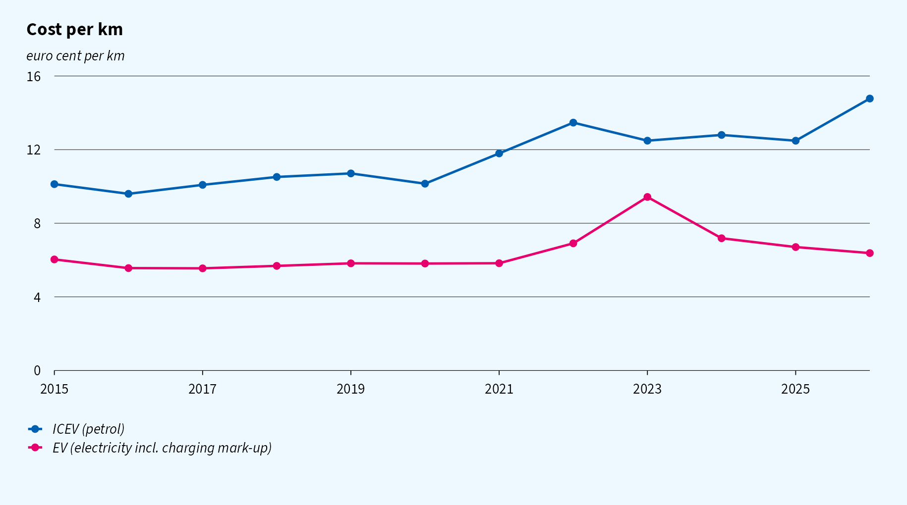
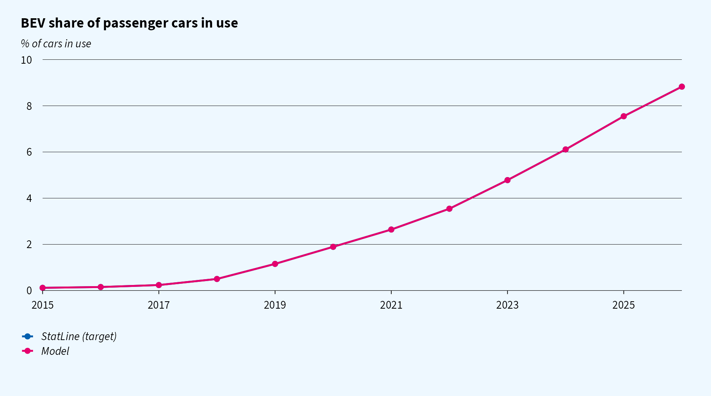
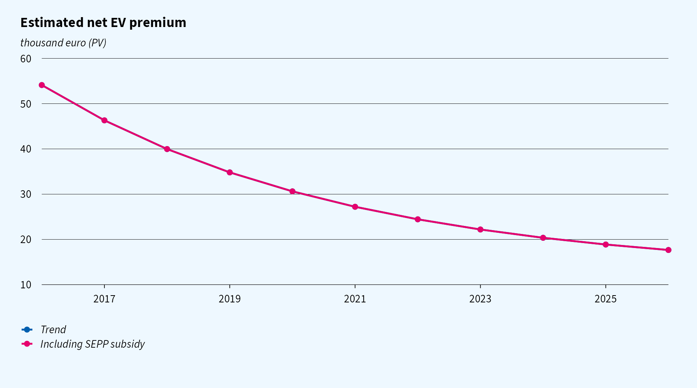
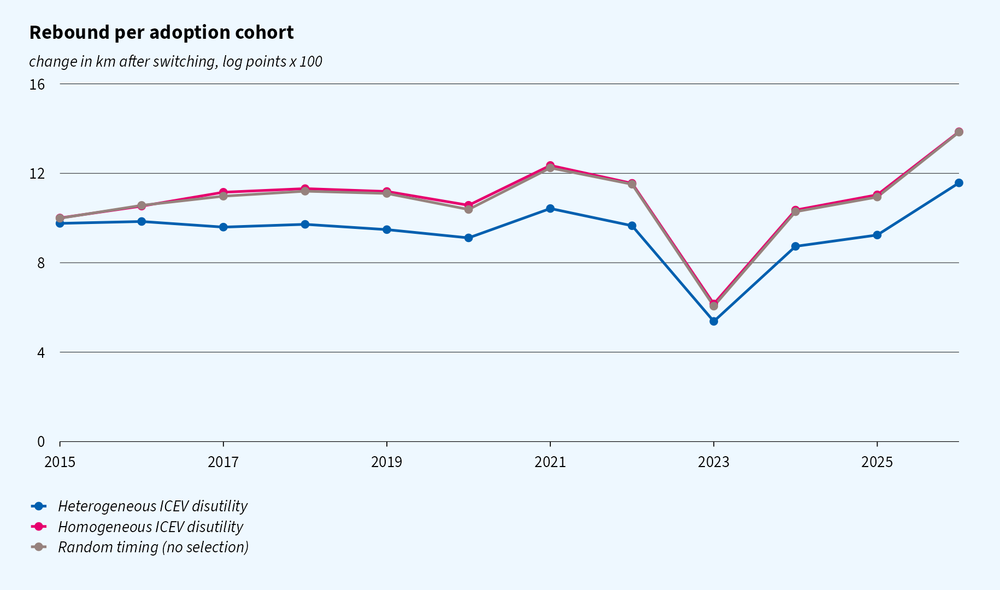
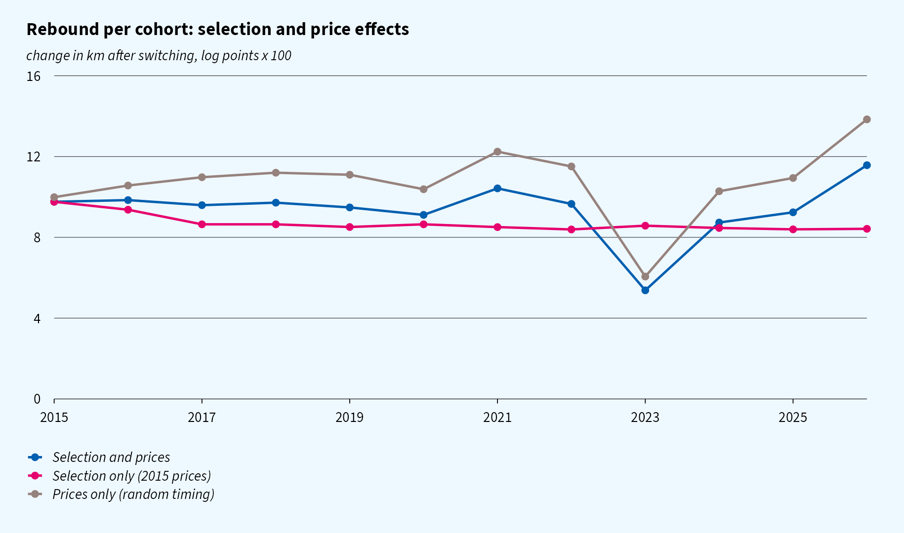
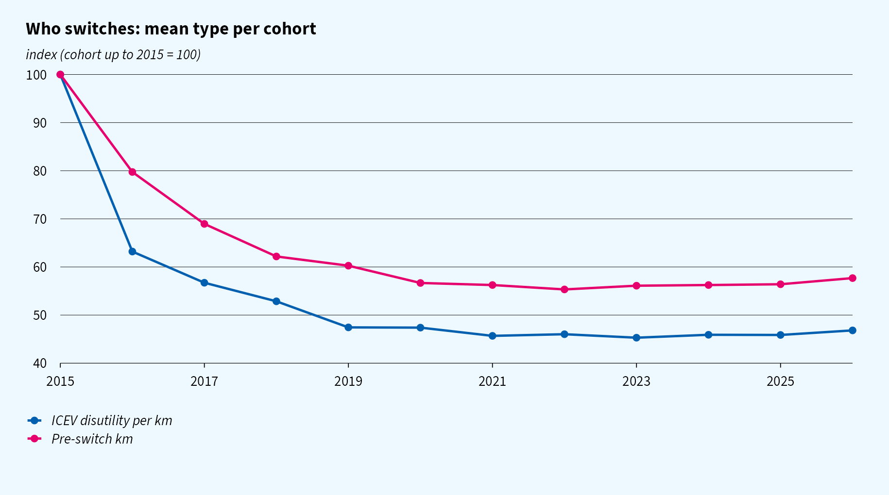
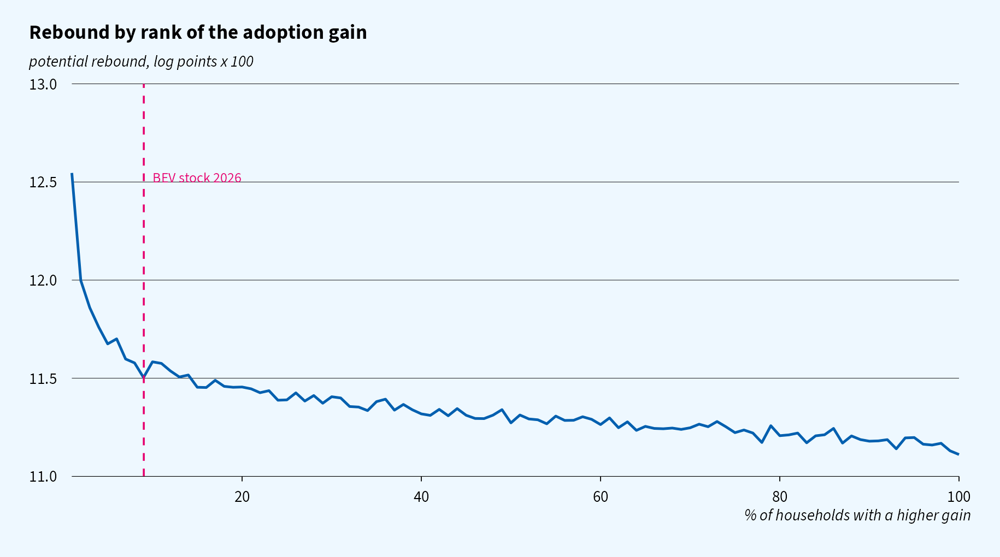
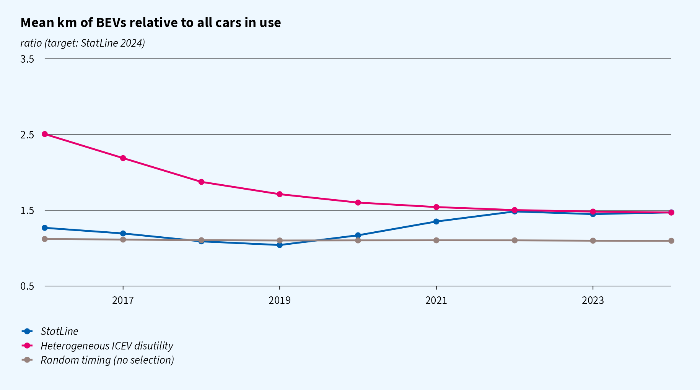

```{r setup, include = FALSE}
library(data.table)
knitr::opts_chunk$set(echo = FALSE, message = FALSE, warning = FALSE, out.width = "100%")

res <- readRDS("../output/results.rds")
statline <- fread("../data/statline_bev_share.csv")
p <- res$params
cal <- res$calibrated
base <- res$cohorts[scenario == "baseline"]
cb <- cal[scenario == "baseline"]
ch <- cal[scenario == "homogeneous_psi"]
fit <- res$fit

fmt <- function(x, d = 1) formatC(x, format = "f", digits = d, big.mark = ",")
pct <- function(x, d = 1) fmt(100 * x, d)
```

> **Status.** This is a working model. The rebound target (10 log points for the 2015 cohort)
> is a **fictitious placeholder**, to be replaced by register-data estimates per cohort. The
> levels are illustrative.
> `r if (knitr::is_latex_output()) "" else "A [PDF version](ev_rebound.pdf) is also available."`

# Question

How does the driving rebound of households that switch from an ICEV to a BEV develop over
time as the fleet electrifies?

# Model

## Driving

The model makes one behavioural assumption about heterogeneity: **households differ in their
disutility from driving an ICEV**, for example because of climate concerns. Who switches
when, and each cohort's rebound, follow from optimising behaviour and the observed diffusion
of BEVs.

A household $i$ owns one car. The perceived cost per km in year $t$ is

$$
c^I_{it} = p^f_t + \psi_i \quad\text{(ICEV)}, \qquad c^E_t \quad\text{(EV)},
$$

where $\psi_i \ge 0$ is the household's disutility per km driven with an ICEV. This is the
heterogeneous primitive. The fuel cost $p^f_t$ and the EV cost $c^E_t$ follow the annual
petrol and electricity prices (see [Prices](#prices)). Demand for km has a common
elasticity,

$$
v_{it}(c) = k_i \left(\frac{c}{c^I_{i,2015}}\right)^{-\varepsilon},
$$

where $k_i$ is the household's km with an ICEV at 2015 prices. The rebound of a household
that switches in year $t$ is the log change in km at that year's prices:

$$
r_{it} = \varepsilon \ln\frac{p^f_t + \psi_i}{c^E_t}.
$$

The rebound of a cohort therefore changes for two reasons: **selection**, i.e. who switches
(their $\psi_i$), and **prices**, i.e. the gap between the cost per km of petrol and
electricity in the switch year.

## Prices

- ICEV: $p^f_t$ = 6.5 l/100 km × the annual mean Euro95 pump price (StatLine 80416ned).
- EV: $c^E_t$ = 0.17 kWh/km × (marginal household electricity price + a charging mark-up of
  €`r fmt(p$charge_markup, 2)`/kWh for the mix of home and public charging).
- The marginal electricity price is the variable delivery tariff plus energy tax and ODE,
  including VAT (StatLine 84672NED and 85592NED). Fixed costs and the fixed tax refund do
  not change with an extra kWh, so they are left out. For 2015–2017 the price is backcast
  from the delivery price (85666NED) plus the statutory energy tax and ODE; on 2018–2019 the
  backcast is within 3–6% of the observed price.
- Households value the driving gain at current prices (static expectations).

```{r}

```

## Adoption

The gain from switching is the present value of the extra surplus from driving, plus the
**status** that owning an EV gives. Households value this status differently,
$g_i \sim N(0,\sigma_g^2)$. Status is positional: it fades as EVs become common, with
weight $\phi(S_{t-1})$ in last year's BEV share. Status affects the decision to switch, but
not how much the household drives:

$$
G_{it} = A \int_{c^E_t}^{c^I_{it}} v_{it}(c)\,dc + \phi(S_{t-1})\,g_i
= A\,\frac{k_i\,(c^I_{i,2015})^{\varepsilon}}{1-\varepsilon}\left[(c^I_{it})^{1-\varepsilon}-(c^E_t)^{1-\varepsilon}\right] + \phi(S_{t-1})\,g_i ,
\qquad \phi(S) = 0.5^{\,S/\bar S}.
$$

Here:

- $A$ is an annuity factor over $`r p$horizon`$ years at $`r 100 * p$disc`\%$;
- status halves with every $\bar S = `r 100 * p$status_halving_share`$ percentage points of
  BEV share.

A household can only switch when it replaces its car, which it does with probability
$\lambda = `r p$replace_rate`$ per year. It then switches if $G_{it} \ge F_t$. The net EV
premium $F_t$ declines smoothly, and is lowered by the SEPP purchase subsidy (2020–2024) with
pass-through $\omega$. The pass-through is below one because SEPP was budget-capped and only
for private buyers:

$$
F_t = F_\infty + (F_0 - F_\infty)\,e^{-\gamma (t - 2016)} - \omega\,\text{SEPP}_t .
$$

As status fades, the driving gain weighs more in the decision, which sharpens selection on
$\psi$ in later cohorts. Up to 2026 the effect is small, because the BEV share stays below
10%.

## What the model implies for rebound over time

Both the gain and the rebound rise in $\psi_i$:

$$
\frac{\partial G_{it}}{\partial \psi_i} > 0, \qquad
\frac{\partial r_{it}}{\partial \psi_i} = \frac{\varepsilon}{c^I_{it}} > 0 .
$$

Households with a high ICEV disutility therefore switch earlier *and* rebound more. As
$F_t$ falls, adoption moves to households with a lower $\psi$, and the cohort rebound
declines.

How strong this is depends on how much of the variation in $G$ comes from $\psi$ rather than
from $k$ and $g$. Those two shift adoption but not the rebound. With a homogeneous $\psi$, or
with adoption timing unrelated to type, rebound is the same for every cohort.

## Assumptions

| Parameter | Value | Basis |
|---|---|---|
| fuel cost $p^f_t$ | 6.5 l/100 km × Euro95 price | StatLine 80416ned |
| EV cost $c^E_t$ | 0.17 kWh/km × (electricity price + €`r fmt(p$charge_markup, 2)`/kWh) | StatLine 84672NED, 85592NED; mark-up assumed |
| ICEV disutility $\psi$ | lognormal, mean €`r p$psi_mean`/km, sdlog **estimated** | mean: about €130/tCO~2~ at 0.15 kg/km |
| km $k$ | lognormal, mean `r fmt(p$km_mean, 0)`, sdlog `r p$km_sdlog` | CBS: about 12,300 km |
| elasticity $\varepsilon$ | common, **estimated** | |
| status sd $\sigma_g$ | **estimated** | |
| status halving share $\bar S$ | `r 100 * p$status_halving_share`% BEV share | assumption |
| SEPP subsidy | €4,000 (2020–21), €3,350 (2022), €2,950 (2023–24) | RVO |
| premium path $F_0, F_\infty, \gamma$, SEPP pass-through $\omega$ | **estimated** | |
| replacement rate $\lambda$ | `r p$replace_rate` | |

All type components are drawn independently.

# Calibration

The parameters are estimated by simulated method of moments. Because the premium path is
restricted to a smooth decline plus the known SEPP subsidy, the model no longer matches the
BEV share by construction. The shape of the S-curve, and the response to the subsidy, then
inform how dispersed the adoption gain is.

| Moment | Source |
|---|---|
| BEV share of cars in use, 2016–2026 (relative deviations) | StatLine 83703NED, 85405NED; 2025–2026 extended with new BEV sales (85898NED) |
| rebound of the 2015 cohort (all adopters up to 2015) = 10 log points | **placeholder** |
| km of BEVs / all cars in use, 2024 = `r fmt(statline[year == 2024, km_ratio], 2)` | StatLine 85405NED |

| Estimated parameter | Heterogeneous $\psi$ | Homogeneous $\psi$ |
|---|---|---|
| elasticity $\varepsilon$ | `r fmt(cb$eps, 3)` | `r fmt(ch$eps, 3)` |
| status sd $\sigma_g$ | €`r fmt(cb$g_sd, 0)` | €`r fmt(ch$g_sd, 0)` |
| ICEV disutility sdlog | `r fmt(cb$psi_sdlog, 2)` | 0 (fixed) |
| premium $F_0$ / $F_\infty$ | €`r fmt(cb$F_0, 0)` / €`r fmt(cb$F_inf, 0)` | €`r fmt(ch$F_0, 0)` / €`r fmt(ch$F_inf, 0)` |
| premium decline $\gamma$ | `r fmt(cb$F_gamma, 3)` | `r fmt(ch$F_gamma, 3)` |
| SEPP pass-through $\omega$ | `r fmt(cb$sepp_weight, 2)` | `r fmt(ch$sepp_weight, 2)` |
| loss (sum of squared deviations) | `r fmt(cb$loss, 4)` | `r fmt(ch$loss, 4)` |

The BEV share uses the 'full elektrisch' category. The fuel type 'Elektriciteit' in the
fleet tables includes hybrids.

In the simulation, the threshold rule is smoothed: a household that replaces its car adopts
with probability $\Lambda((G_{it} - F_t)/\tau)$, with $\tau$ = €`r fmt(p$smooth_tau, 0)`.
This keeps all moments continuous in the parameters. The estimation runs on 250,000
simulated households; the results below use 1,000,000.

```{r}

```

```{r}

```

Three findings from the estimation:

- **The share path is fitted well** with a premium that falls from about
  €`r fmt(cb$F_0 / 1000, 0)`k in 2016 towards €`r fmt(cb$F_inf / 1000, 0)`k.
- **The SEPP pass-through is estimated at zero.** The share path shows no visible jump when
  the subsidy started (2020) or stopped (2025).
- **The share path does not tell the two models apart.** The heterogeneous and the homogeneous
  ICEV disutility fit about equally well (losses `r fmt(cb$loss, 3)` and `r fmt(ch$loss, 3)`
  on the full population; the small difference is simulation noise). So the estimated spread
  of $\psi$ (sdlog `r fmt(cb$psi_sdlog, 2)`) is only weakly identified. The rebound per
  cohort from register data is what will discipline it.

# Results

## Rebound over time

With a heterogeneous ICEV disutility, the cohort rebound goes from
`r pct(base[cohort == min(cohort), rebound_log])` log points (adopters up to 2015) to
`r pct(base[cohort == max(cohort), rebound_log])` (2026). With a homogeneous disutility, or with
random timing, there is no selection, and the profile only moves with prices. Each scenario
is recalibrated to the same 2015 target.

```{r}

```

## Selection and price effects

The figure below separates the two forces:

- **Selection only** evaluates every cohort at 2015 prices. It falls from
  `r pct(base[cohort == min(cohort), rebound_const])` to
  `r pct(base[cohort == max(cohort), rebound_const])` log points, because later cohorts have a
  lower ICEV disutility.
- **Prices only** (random timing) shows how the cost gap moves the rebound of a
  representative switcher.

Over 2015–2026 the gap between the cost per km of petrol and electricity did **not** narrow.
Petrol became more expensive faster than charging, so the log cost ratio rose from
`r fmt(res$cost_path[year == 2015, log_ratio], 2)` to
`r fmt(res$cost_path[year == max(year), log_ratio], 2)`. The exception is 2023, when the
electricity price spike cut it to `r fmt(res$cost_path[year == 2023, log_ratio], 2)`.
Prices therefore cannot explain a lasting decline in rebound: they push it up over the
period, with a temporary dip for the 2023 cohort. In the model, a lasting decline has to come
from selection.

```{r}

```

## Who switches

Early cohorts have a high ICEV disutility and drive a lot. Both fall as the fleet
electrifies.

```{r}

```

The figure below shows the rebound each household would have if it switched, ordered by its
gain. The remaining ICEV owners would rebound somewhat less than the first adopters, but the
curve is flat over most of the population.

```{r}

```

## Untargeted check: km of BEVs over time

The model matches the 2024 ratio. In earlier years, it has BEVs driven far more than the
average car, while StatLine shows a modest ratio that rises over time. This points to
constraints the model leaves out:

- the limited range of early BEVs;
- company cars.

```{r}

```

# Next steps

1. Target the full **rebound profile per cohort** from register data. Whether, and how
   steeply, it declines identifies how dispersed the ICEV disutility is.
2. Add a **range constraint** that loosens over time, and a **company car segment**.
3. Separate **cohort, period and duration effects**, using ICEV-to-ICEV replacers as
   controls.
4. Compute the **rebound of the remaining ICEV owners** under a phase-out.

---

Code: [`R/`](https://github.com/joris-klingen/ev_reb_model/tree/main/R). Specification:
[`docs/model.md`](https://github.com/joris-klingen/ev_reb_model/blob/main/docs/model.md).
Figures: [ggcpb](https://github.com/joris-klingen/ggcpb), open source fallback font.
