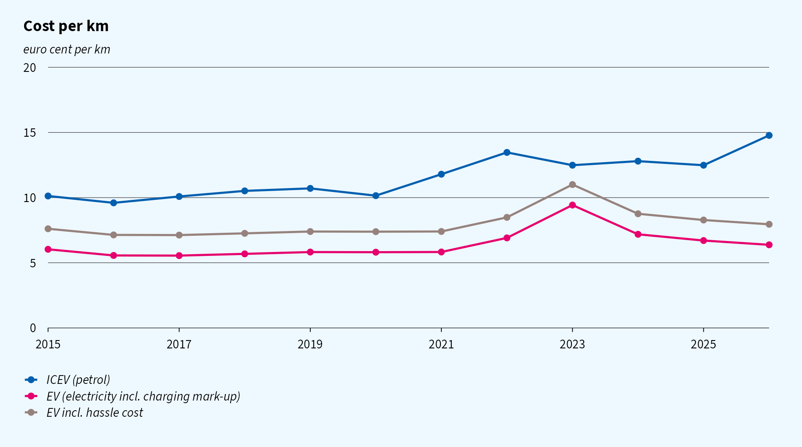
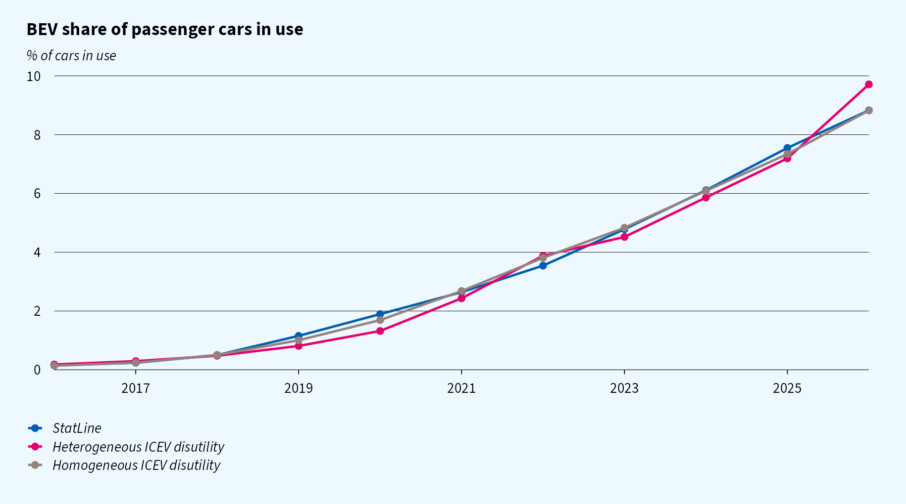
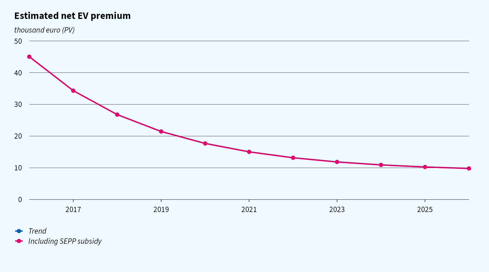
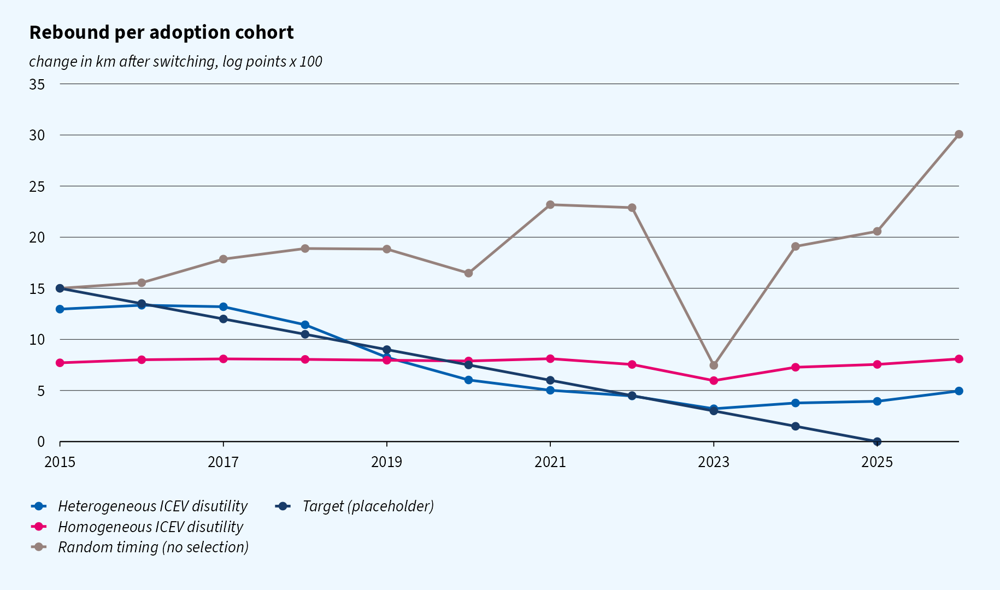
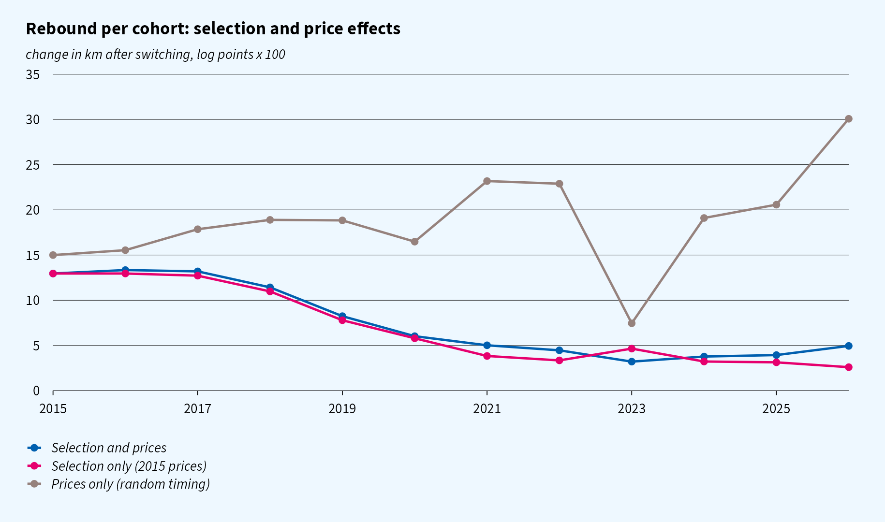
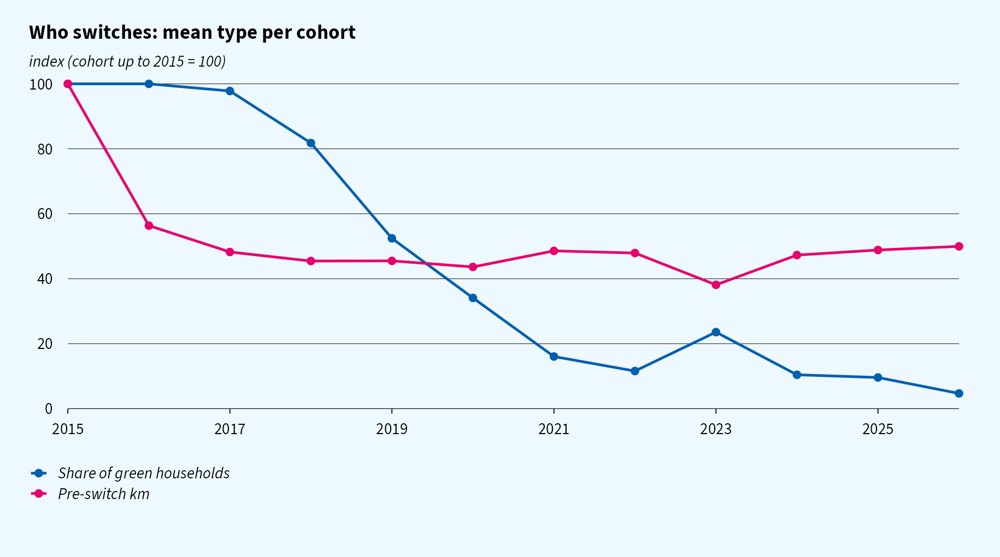
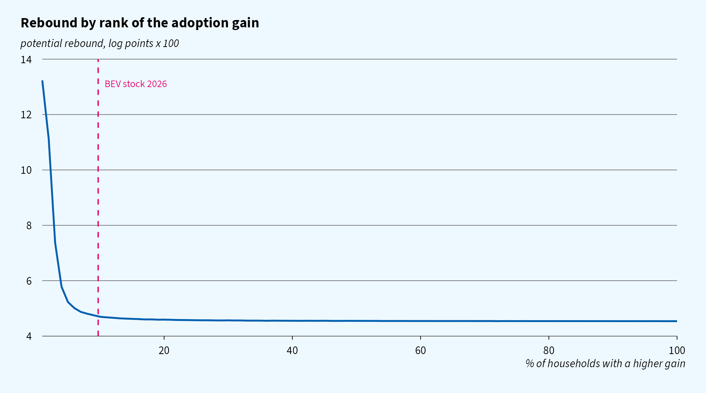
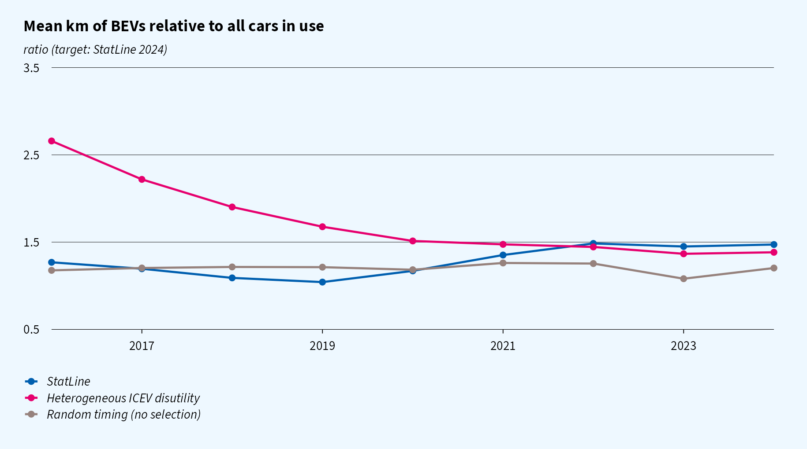

EV rebound in an electrifying fleet
================
Working draft, 10 November 2026

- [Question](#question)
- [Model](#model)
  - [Driving](#driving)
  - [Prices](#prices)
  - [Adoption](#adoption)
  - [What the model implies for rebound over
    time](#what-the-model-implies-for-rebound-over-time)
  - [Assumptions](#assumptions)
- [Calibration](#calibration)
- [Results](#results)
  - [Rebound over time](#rebound-over-time)
  - [Selection and price effects](#selection-and-price-effects)
  - [Who switches](#who-switches)
  - [Untargeted check: km of BEVs over
    time](#untargeted-check-km-of-bevs-over-time)
- [Next steps](#next-steps)

> **Status.** This is a working model. The rebound targets (a linear
> decline from 15 log points for the 2015 cohort to 0 for the 2025
> cohort) are **fictitious placeholders**, to be replaced by
> register-data estimates per cohort. The levels are illustrative. A
> [PDF version](ev_rebound.pdf) is also available.

# Question

How does the driving rebound of households that switch from an ICEV to a
BEV develop over time as the fleet electrifies?

# Model

## Driving

The model makes one behavioural assumption about heterogeneity:
**households differ in their disutility from driving an ICEV**, for
example because of climate concerns. There are two types: a share $\pi$
of “green” households with disutility $\psi_H$ per ICEV km, and all
others with none. Who switches when, and each cohort’s rebound, follow
from optimising behaviour and the observed diffusion of BEVs.

A household $i$ owns one car. The perceived cost per km in year $t$ is

$$
c^I_{it} = p^f_t + \psi_i \quad\text{(ICEV)}, \qquad c^E_t + \kappa \quad\text{(EV)},
$$

where $\psi_i \ge 0$ is the household’s disutility per km driven with an
ICEV. This is the heterogeneous primitive. The fuel cost $p^f_t$ and the
EV cost $c^E_t$ follow the annual petrol and electricity prices (see
[Prices](#prices)). Demand for km has a common elasticity,

$$
v_{it}(c) = k_i \left(\frac{c}{c^I_{i,2015}}\right)^{-\varepsilon},
$$

where $k_i$ is the household’s km with an ICEV at 2015 prices. The
rebound of a household that switches in year $t$ is the log change in km
at that year’s prices:

$$
r_{it} = \varepsilon \ln\frac{p^f_t + \psi_i}{c^E_t + \kappa}.
$$

Here $\kappa$ is a hassle cost per EV km (charging time, limited range),
the same for every household. Because EV km are cheaper in money terms,
without $\kappa$ every switcher would rebound by at least
$\varepsilon \ln(p^f_t / c^E_t) > 0$. With $\kappa$, a household whose
ICEV disutility is low has little or no rebound, while households with a
high $\psi_i$ still drive more after switching.

The rebound of a cohort therefore changes for two reasons:
**selection**, i.e. who switches (their $\psi_i$), and **prices**,
i.e. the gap between the cost per km of petrol and electricity in the
switch year.

## Prices

- ICEV: $p^f_t$ = 6.5 l/100 km × the annual mean Euro95 pump price
  (StatLine 80416ned).
- EV: $c^E_t$ = 0.17 kWh/km × (marginal household electricity price + a
  charging mark-up of €0.12/kWh for the mix of home and public
  charging).
- The marginal electricity price is the variable delivery tariff plus
  energy tax and ODE, including VAT (StatLine 84672NED and 85592NED).
  Fixed costs and the fixed tax refund do not change with an extra kWh,
  so they are left out. For 2015–2017 the price is backcast from the
  delivery price (85666NED) plus the statutory energy tax and ODE; on
  2018–2019 the backcast is within 3–6% of the observed price.
- Households value the driving gain at current prices (static
  expectations).
- 2026 prices cover only part of the year (petrol to late October,
  electricity to September).

## Adoption

The gain from switching is the present value of the extra surplus from
driving, plus the **status** that owning an EV gives. Households value
this status differently, $g_i \sim N(0,\sigma_g^2)$. Status is
positional: it fades as EVs become common, with weight $\phi(S_{t-1})$
in last year’s BEV share. Status affects the decision to switch, but not
how much the household drives:

$$
G_{it} = A \int_{c^E_t + \kappa}^{c^I_{it}} v_{it}(c)\,dc + \phi(S_{t-1})\,g_i
= A\,\frac{k_i\,(c^I_{i,2015})^{\varepsilon}}{1-\varepsilon}\left[(c^I_{it})^{1-\varepsilon}-(c^E_t + \kappa)^{1-\varepsilon}\right] + \phi(S_{t-1})\,g_i ,
\qquad \phi(S) = 0.5^{\,S/\bar S}.
$$

Here:

- $A$ is an annuity factor over $8$ years at $4\%$;
- status halves with every $\bar S = 10$ percentage points of BEV share.

A household can only switch when it replaces its car, which it does with
probability $\lambda = 0.12$ per year. It then switches if
$G_{it} \ge F_t$. The net EV premium $F_t$ declines smoothly, and is
lowered by the SEPP purchase subsidy (2020–2024) with pass-through
$\omega$. The pass-through is below one because SEPP was budget-capped
and only for private buyers:

$$
F_t = F_\infty + (F_0 - F_\infty)\,e^{-\gamma (t - 2016)} - \omega\,\text{SEPP}_t .
$$

As status fades, the driving gain weighs more in the decision, which
sharpens selection on $\psi$ in later cohorts. Up to 2026 the effect is
small, because the BEV share stays below 10%.

## What the model implies for rebound over time

Both the gain and the rebound rise in $\psi_i$:

$$
\frac{\partial G_{it}}{\partial \psi_i} > 0, \qquad
\frac{\partial r_{it}}{\partial \psi_i} = \frac{\varepsilon}{c^I_{it}} > 0 .
$$

Households with a high ICEV disutility therefore switch earlier *and*
rebound more. As $F_t$ falls, adoption moves to households with a lower
$\psi$, and the cohort rebound declines. With two types the logic is
stark: the green households switch first and rebound; once most of them
have switched, the cohorts consist of households without ICEV
disutility, whose rebound is
$\varepsilon \ln(p^f_t / (c^E_t + \kappa))$, close to zero when the
hassle cost offsets the money saving per km.

How strong this is depends on how much of the variation in $G$ comes
from $\psi$ rather than from $k$ and $g$. Those two shift adoption but
not the rebound. With a homogeneous $\psi$, or with adoption timing
unrelated to type, rebound is the same for every cohort.

## Assumptions

| Parameter                                                        | Value                                                                                      | Basis                                        |
|------------------------------------------------------------------|--------------------------------------------------------------------------------------------|----------------------------------------------|
| fuel cost $p^f_t$                                                | 6.5 l/100 km × Euro95 price                                                                | StatLine 80416ned                            |
| EV cost $c^E_t$                                                  | 0.17 kWh/km × (electricity price + €0.12/kWh)                                              | StatLine 84672NED, 85592NED; mark-up assumed |
| EV hassle cost $\kappa$                                          | €/km, **estimated**                                                                        | charging time, range                         |
| ICEV disutility $\psi$                                           | two types: a share $\pi$ of green households with $\psi_H$, the rest 0; both **estimated** |                                              |
| km $k$                                                           | lognormal, mean 13,000, sdlog 0.55                                                         | CBS: about 12,300 km                         |
| elasticity $\varepsilon$                                         | common, **estimated**                                                                      |                                              |
| status sd $\sigma_g$                                             | **estimated**                                                                              |                                              |
| status halving share $\bar S$                                    | 10% BEV share                                                                              | assumption                                   |
| SEPP subsidy                                                     | €4,000 (2020–21), €3,350 (2022), €2,950 (2023–24)                                          | RVO                                          |
| premium path $F_0, F_\infty, \gamma$, SEPP pass-through $\omega$ | **estimated**                                                                              |                                              |
| replacement rate $\lambda$                                       | 0.12                                                                                       |                                              |

All type components are drawn independently.

# Calibration

The parameters are estimated by simulated method of moments. Because the
premium path is restricted to a smooth decline plus the known SEPP
subsidy, the model no longer matches the BEV share by construction. The
shape of the S-curve, and the response to the subsidy, then inform how
dispersed the adoption gain is.

| Moment                                                                                              | Source                                                                        |
|-----------------------------------------------------------------------------------------------------|-------------------------------------------------------------------------------|
| BEV share of cars in use, 2016–2026 (relative deviations)                                           | StatLine 83703NED, 85405NED; 2025–2026 extended with new BEV sales (85898NED) |
| rebound per cohort 2015–2025, linear from 15 log points (2015, all adopters up to 2015) to 0 (2025) | **placeholder**                                                               |
| km of BEVs / all cars in use, 2024 = 1.47                                                           | StatLine 85405NED                                                             |

| Estimated parameter                          | Heterogeneous $\psi$ | Homogeneous $\psi$ |
|----------------------------------------------|----------------------|--------------------|
| elasticity $\varepsilon$                     | 0.073                | 0.047              |
| status sd $\sigma_g$                         | €8,322               | €58,218            |
| share of green households $\pi$              | 2.6%                 | 100% (fixed)       |
| ICEV disutility of green households $\psi_H$ | €0.345/km            | €0.215/km          |
| EV hassle cost $\kappa$                      | €0.016/km            | €0.000/km          |
| premium $F_0$ / $F_\infty$                   | €45,033 / €8,703     | €188,915 / €38,888 |
| premium decline $\gamma$                     | 0.349                | 0.200              |
| SEPP pass-through $\omega$                   | 0.00                 | 0.00               |
| loss (sum of squared deviations)             | 1.6321               | 8.7951             |

The BEV share uses the ‘full elektrisch’ category. The fuel type
‘Elektriciteit’ in the fleet tables includes hybrids.

In the simulation, the threshold rule is smoothed: a household that
replaces its car adopts with probability $\Lambda((G_{it} - F_t)/\tau)$,
with $\tau$ = €1,000. Each simulated household appears once as each
type, weighted by $\pi$ and $1-\pi$, which keeps the moments smooth in
$\pi$ as well. This keeps all moments continuous in the parameters. The
estimates come from a search on 50,000 simulated households; the results
below are simulated on 200,000 households, so the reported losses differ
slightly from the estimation.

Findings from the estimation:

- **Green households are few but decisive.** About 2.6% of households
  are green, with an ICEV disutility of €0.34 per km. They make up
  almost all early adopters and have largely switched by 2021.
- **The rebound path separates the two models.** With one disutility for
  everyone, the model cannot produce a declining rebound, and its loss
  is 8.80 against 1.63 with two types.
- **The decline stops short of zero.** Households without ICEV
  disutility still rebound by a few log points, because the estimated
  hassle cost (€0.016/km) only partly offsets the money saved per EV km.
  A larger hassle cost would lower the adoption gain and worsen the fit
  to the share path.
- **The share path is fitted reasonably** (within about 30% in every
  year) with a premium that falls from €45k in 2016 towards €9k. The
  SEPP pass-through is estimated at zero.

# Results

## Rebound over time

With a heterogeneous ICEV disutility, the cohort rebound goes from 13.0
log points (adopters up to 2015) to 5.0 (2026). With a homogeneous
disutility, or with random timing, there is no selection, and the
profile only moves with prices. Each scenario is re-estimated on the
same targets; random timing can only match the 2015 target, because
without selection every cohort has the same rebound at given prices.

## Selection and price effects

The figure below separates the two forces:

- **Selection only** evaluates every cohort at 2015 prices. It falls
  from 13.0 to 2.6 log points, because later cohorts have a lower ICEV
  disutility.
- **Prices only** (random timing) shows how the cost gap moves the
  rebound of a representative switcher.

Over 2015–2026 the gap between the cost per km of petrol and electricity
did **not** narrow. Petrol became more expensive faster than charging,
so the log cost ratio rose from 0.52 to 0.84. The exception is 2023,
when the electricity price spike cut it to 0.28. Prices therefore cannot
explain a lasting decline in rebound: they push it up over the period,
with a temporary dip for the 2023 cohort. In the model, a lasting
decline has to come from selection.

## Who switches

The share of green households among switchers falls from almost all of
the first cohorts to a small minority after 2021. Pre-switch km fall as
well.

The figure below shows the rebound each household would have if it
switched, ordered by its gain. The remaining ICEV owners would rebound
somewhat less than the first adopters, but the curve is flat over most
of the population.

## Untargeted check: km of BEVs over time

The model matches the 2024 ratio. In earlier years, it has BEVs driven
far more than the average car, while StatLine shows a modest ratio that
rises over time. This points to constraints the model leaves out:

- the limited range of early BEVs;
- company cars.

# Next steps

1.  Target the full **rebound profile per cohort** from register data.
    Whether, and how steeply, it declines identifies how dispersed the
    ICEV disutility is.
2.  Add a **range constraint** that loosens over time, and a **company
    car segment**.
3.  Separate **cohort, period and duration effects**, using ICEV-to-ICEV
    replacers as controls.
4.  Compute the **rebound of the remaining ICEV owners** under a
    phase-out.

------------------------------------------------------------------------

Code: [`R/`](https://github.com/joris-klingen/ev_reb_model/tree/main/R).
Specification:
[`docs/model.md`](https://github.com/joris-klingen/ev_reb_model/blob/main/docs/model.md).
Figures: [ggcpb](https://github.com/joris-klingen/ggcpb), open source
fallback font.
